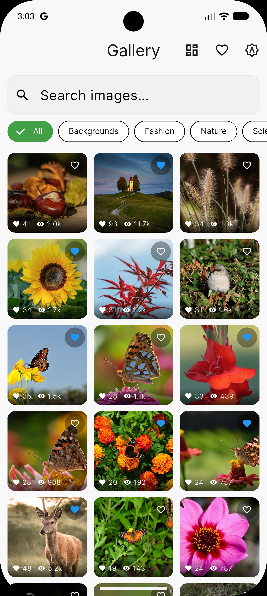
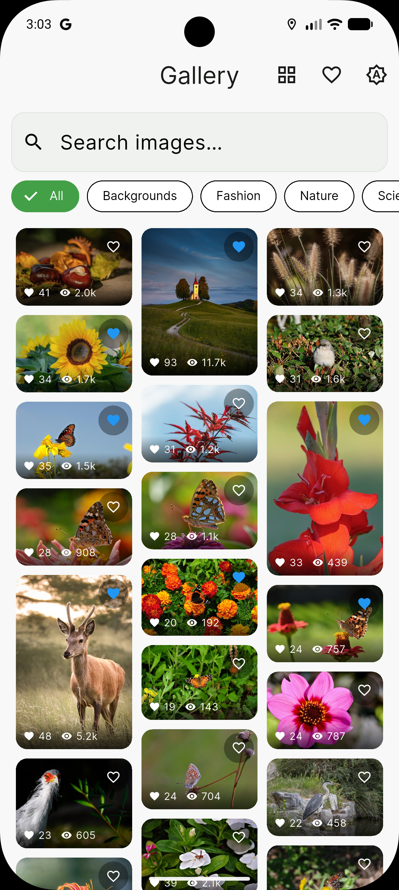
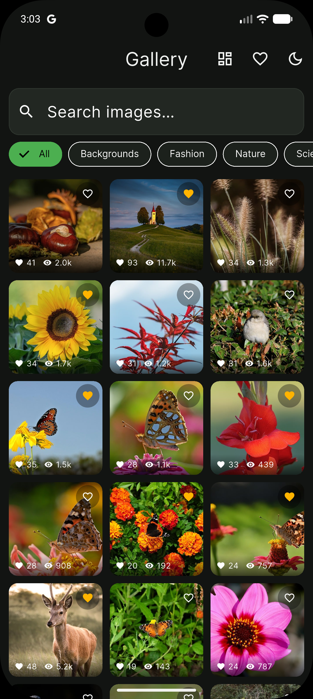
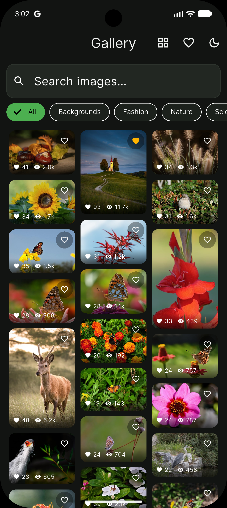
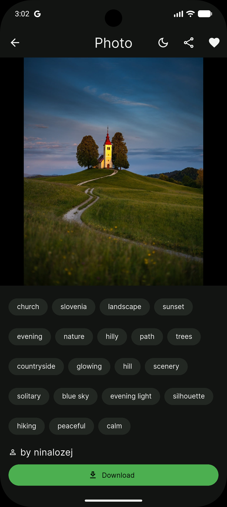
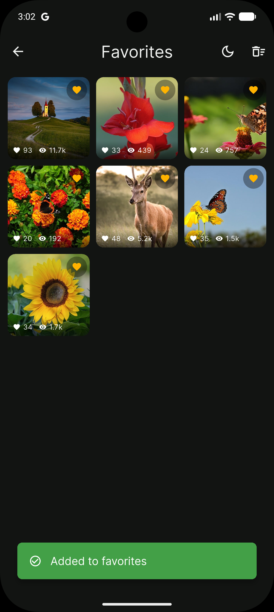

# Infinite Image Gallery — Pixabay

Production-style Flutter image gallery (Clean Architecture + `flutter_bloc`) on the
[Pixabay API](https://pixabay.com/api/docs/): infinite scrolling, search, category
filters, grid/masonry layouts, detail view with description, downloads with progress,
favorites with persistence, sharing, and light/dark themes.

## Screenshots

| Grid (light) | Masonry (light) |
|---|---|
|  |  |

| Grid (dark) | Masonry (dark) |
|---|---|
|  |  |

| Detail (dark) | Favorites (dark) |
|---|---|
|  |  |

## Setup

1. **Requirements:** Flutter 3.47+ (Dart 3.13+), Android SDK / Xcode for device builds.
2. **API key (required):** free at <https://pixabay.com/api/docs/> → copy `.env.example`
   to `.env` and fill in your key (never commit `.env`):
   ```bash
   cp .env.example .env
   # PIXABAY_API_KEY=PASTE_YOUR_KEY_HERE
   ```
3. **Install + run:**
   ```bash
   flutter pub get
   flutter run            # emulator / device
   ```
4. **Tests:** `flutter test` (95 tests) · `flutter analyze` (clean).

## Release APK (obfuscated)

```bash
flutter build apk --release --obfuscate --split-debug-info=build/app/outputs/symbols
```

- Output: `build/app/outputs/flutter-apk/app-release.apk`, copied to
  **`release/gallery-v1.0.0.apk`** (install via
  `adb install -r release/gallery-v1.0.0.apk`).
- Android hardening: `compileSdk 37` (required by `permission_handler`),
  R8 `isMinifyEnabled` + `isShrinkResources` with `proguard-rules.pro`
  (keeps Flutter engine, FileProvider, all plugin channels).
- Debug symbols for de-obfuscating crash traces: `build/app/outputs/symbols/`
  (not committed).
- Signed with debug keys — replace with a real keystore before store upload.

### Platform notes (already configured)

- **Android** (`android/app/src/main/AndroidManifest.xml`): `READ_MEDIA_IMAGES`
  (API 33+), legacy read/write storage (`maxSdkVersion 32`),
  `requestLegacyExternalStorage="true"`.
- **iOS** (`ios/Runner/Info.plist`): `NSPhotoLibraryAddUsageDescription` (+ usage).

## Architecture & state management

Clean Architecture, dependencies point inward only:

```
lib/
  main.dart / app.dart / injection_container.dart   # env → get_it → providers
  core/            # theme, responsive metrics, Dio client, errors, widgets
  features/
    gallery/  data/{models,datasources,repositories} · domain/{entities,repositories,use_cases} · presentation/{bloc,pages,widgets}
    detail/   data/services · presentation/{pages,cubit}
    favorites/ …  · theme/ …
```

- **State:** one Bloc/Cubit per concern — `GalleryBloc` (filters + fetching),
  `FavoritesBloc` (global singleton above `MaterialApp`), `DownloadCubit`
  (per detail page), `ThemeCubit` (global). Paging mechanics stay in
  `infinite_scroll_pagination@5` (`PagingController` + `PagingListener`); the
  Bloc answers *what to fetch* and tags results per page key, so retries never
  cross-talk.
- **Errors:** data exceptions → `Failure`s (`dartz` `Either`) → identical
  loading/error/empty views on every screen; nothing raw reaches the UI.
- **DI:** `get_it` composition root (`lib/injection_container.dart`):
  singletons for shared services, factories for page-scoped Blocs.
- **SOLID:** single-responsibility layers (`DioClient`, `PermissionHelper`,
  `Tools`), small contracts (`GalleryRepository`, `FavoritesRepository`,
  `ImageDownloadService`), UI depends on abstractions wired in one place.

## Packages

| Package | Use |
|---|---|
| `flutter_bloc` + `equatable` | State management |
| `get_it` | Service locator |
| `dartz` | `Either<Failure, T>` |
| `dio` | HTTP (`core/network/dio_client.dart`) |
| `flutter_dotenv` (+ `flutter_secure_storage`) | `.env` API key |
| `shared_preferences` | Favorites + theme persistence |
| `cached_network_image` | Memory/disk image cache |
| `infinite_scroll_pagination` | Paging engine |
| `custom_masonry_grid` | Masonry layout |
| `google_fonts` + `shimmer` | Typography + skeletons |
| `image_gallery_saver_plus` + `permission_handler` (+ `device_info_plus`, `path_provider`) | Gallery save |
| `share_plus` | Sharing |
| `url_launcher` | "View on Pixabay" |
| `bloc_test` + `mocktail` (dev) | Tests |

## Assumptions & limitations

- Pixabay Basic plan: ~100 req/min; deep paging is capped server-side — an
  empty page is treated as end-of-list (see `PhotoPage.isLastPage`).
- Thumbnails use `webformatURL`, detail/download use `largeImageURL`
  (falls back gracefully when absent).
- Favorites store full photo JSON → usable offline; corrupt entries are skipped.
- Download needs a real device/emulator with storage; share needs a share
  target (both degrade to snackbars when unavailable).
- Widget tests use fixed pumps (sandbox blackholes image HTTP, so shimmer
  never settles) — documented in the test files.
